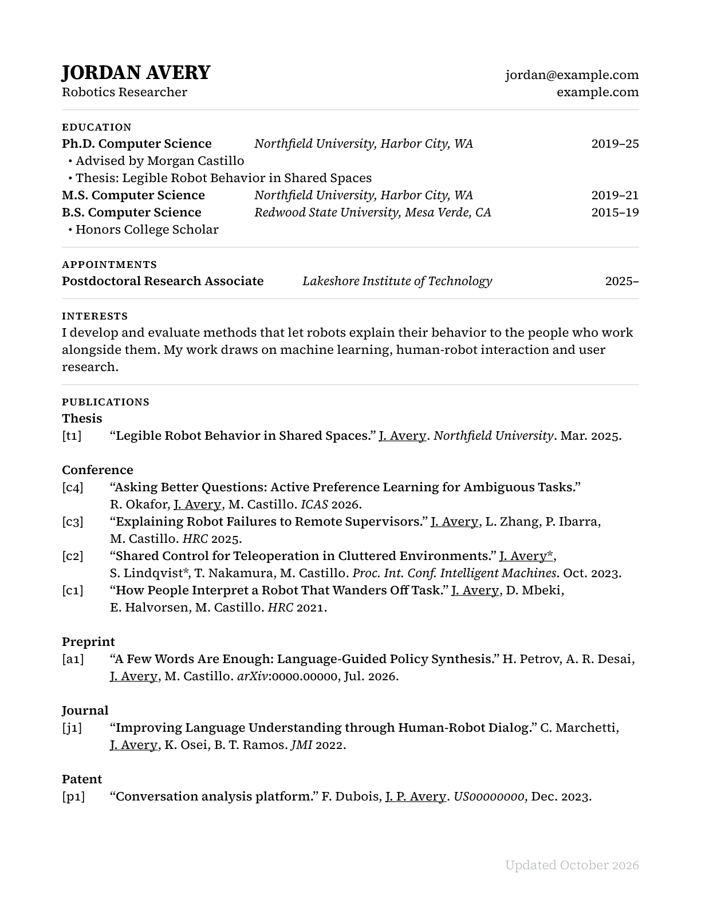

# Typst CV Template

A neatly-set academic CV, generated from a JSON file with [Typst](https://typst.app). Probably good as a resume template too.

* Everything comes from one JSON file, so the same data can feed a website
* Set on a baseline grid, with tab stops chosen per section to fit its content
* Tagged, accessible PDF output (PDF/UA-1) with working links and bookmarks
* Builds out of the box: the fonts are bundled

This is the successor to my [InDesign CV template](https://github.com/nickswalker/indesign-cv-template) and reads the same data format.

## Usage

Install [Typst](https://github.com/typst/typst#installation) (tested with 0.15), then:

    ./build.sh          # writes cv.pdf
    ./build.sh watch    # rebuilds whenever cv.typ or cv.json changes

Replace the contents of `cv.json` with your own details. The schema is an extension of [JSON Resume](https://jsonresume.org/schema/); the bundled file is a fictional CV with an entry of every kind, so use it as the reference.

| Key | Section |
|---|---|
| `basics` | Name, title, contact details and profile links |
| `education`, `appointments`, `interests` | Education, Appointments, Interests |
| `publications` | Publications, grouped by `type` and numbered within each group |
| `research_experience`, `teaching_experience` | Research Experience, Teaching Experience |
| `grants`, `mentoring`, `awards`, `skills` | Grants, Mentoring, Recognition, Skills |
| `volunteer` | Leadership and Professional Service. Entries whose `position` is `Reviewer` are gathered into a compact list of venues and years |

To use a different data file, run `./build.sh compile --input cv=other.json`.

### Publications from BibTeX

If you keep your publications in a .bib file, `update_cv_publications.py` rewrites the `publications` list in `cv.json` from `publications.bib`:

    uv run update_cv_publications.py

(or install `pybtex` and run it with Python). The bundled `publications.bib` documents the extra fields it reads, such as `wwwtype`, which decides the group a publication appears under. Set `LINK_BASE` at the top of the script to where your publication pages live.

## Customizing

The settings most likely to change are at the top of `cv.typ`:

* **Sections**: reorder or comment out entries in `section-order` and `publication-order`.
* **Fonts**: set `body-font` and `name-font`, and put the font files in `fonts/`. The body font needs light, regular, medium, semibold and bold weights and an italic. The build ignores system fonts so that it gives the same result everywhere.
* **Your name in author lists** is underlined automatically, based on `basics.name`.
* **Metrics**: the type size, baseline grid and the 12-column grid that positions the tab stops.

## Notes

* `build.sh` reorders the corner points of link areas after compiling. Without this, links that wrap across lines are only partly clickable in Preview and Safari. `./build.sh watch` skips that step.
* The template is set in [Source Serif 4](https://github.com/adobe-fonts/source-serif), with icons from [Font Awesome 5 Free](https://fontawesome.com/v5/download). Both are distributed under the SIL Open Font License; see `fonts/`.

## License

The template is released under the [MIT License](LICENSE), while the bundled fonts keep their own licenses.
